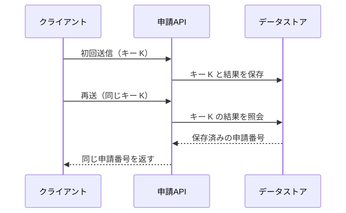

<!-- _class: hero -->
<!-- _paginate: false -->

# API の同時再送を 一度の処理にまとめる

タイムアウト後の再送を安全に扱う設計例

---

## 同じ操作の再送には同じキーを使う

  <article class="card">
    <h3>仕組み</h3>
    
クライアントが操作にキーを付ける。サーバーはキーと処理結果を保存する。

  </article>
  <article class="card">
    <h3>申請 API の例</h3>
    
応答が届かず再送しても、保存済みの申請番号を返せる。

  </article>

---

## 再送時は保存済みの結果を返す

  

---

## キーの取得と保存には一意性を持たせる

  

    <pre><code>UNIQUE (account_id, operation_key)</code></pre>
  

  <article class="card">
    <h3>同時再送</h3>
    
同じキーを二つの処理が同時に取得できないようにする。完了済みなら結果を返し、処理中なら再試行を案内する。

  </article>

---

## 次の API 設計で確認すること

  <article class="card"><h3>キーの範囲</h3>
アカウントと操作の組で一意にする。
</article>
  <article class="card"><h3>内容の一致</h3>
本文が異なるキーの再利用はエラーにする。
</article>
  <article class="card"><h3>保持期間</h3>
クライアントの再試行期間に合わせて決める。
</article>

